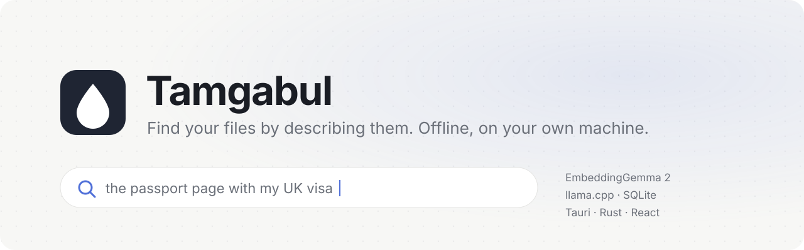
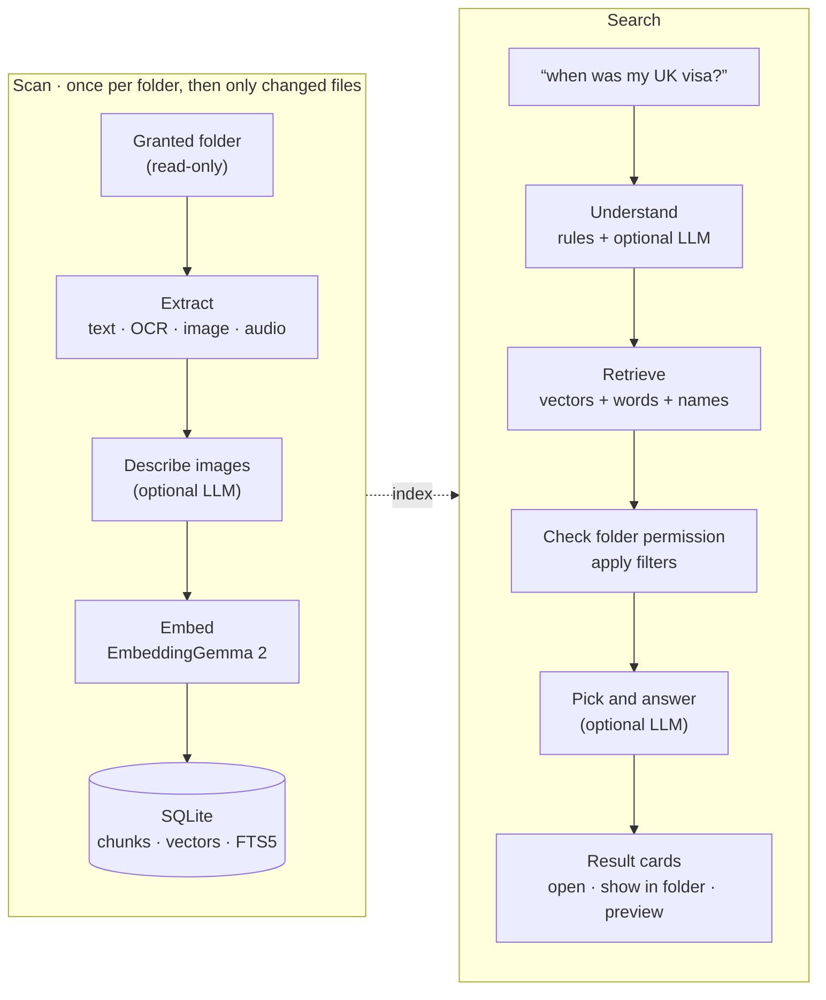
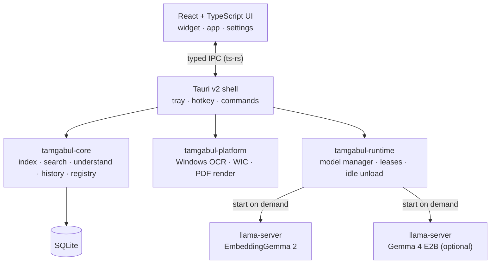

<p align="center">
  <a href="README.md">🇬🇧 English</a>
  &nbsp;·&nbsp;
  <a href="README.tr.md">🇹🇷 Türkçe</a>
</p>

<p align="center">
  <picture>
    <source media="(prefers-color-scheme: dark)" srcset="docs/assets/banner-dark.svg">
    
  </picture>
</p>

<p align="center">
  <a href="https://github.com/hikmetbozkurt/Tamgabul/actions/workflows/ci.yml"></a>
  
  
  
</p>

<p align="center">
  <a href="#why-tamgabul">Why</a> ·
  <a href="#features">Features</a> ·
  <a href="#how-it-works">How it works</a> ·
  <a href="#quick-start">Quick start</a> ·
  <a href="#project-structure">Structure</a> ·
  <a href="#status-and-limitations">Status</a> ·
  <a href="#roadmap">Roadmap</a>
</p>

---

**Tamgabul** is a desktop widget that finds files on your computer from a plain description, such as *“the passport page with my UK visa”* or *“geçen haftaki fatura PDF'i”*. You point it at folders once. It reads documents, images and recordings with local models, and after that you ask in everyday Turkish or English. Nothing leaves your machine.

## Why Tamgabul

- **You describe, it finds.** You don't need to remember a file name or a folder. The search matches meaning, words, text inside images, and file names.
- **Local-only.** Models run on your machine through `llama.cpp`. There is no cloud inference, no telemetry, and models are never downloaded on their own.
- **Your files stay untouched.** Folders are opened read-only. Removing a folder deletes its index right away and never deletes your files.
- **Models don't sit in memory.** A model starts when a scan or search needs it and stops after it has been idle. You choose the idle time for each model, or unload everything from the tray.

## Features

| | What it does today |
|---|---|
| **Search in everyday words** | Meaning (EmbeddingGemma 2 vectors) + words (SQLite FTS5) + file names, fused with reciprocal rank fusion. Every result is re-checked against your folder permissions before it is shown or opened. |
| **Turkish-aware matching** | `toplanti` finds *Toplantı*, `surum` finds *sürüm*: I/İ/ı and accents are folded the same way on both sides. |
| **Understands the request** | Rules turn *dün, geçen hafta, bu ay, PDF, ekran görüntüsü, ses kaydı* (and English equivalents) into date and file-type filters. A request with only filters lists the newest matching files. |
| **Optional local LLM** | With Gemma 4 E2B: base forms and TR↔EN synonyms of your words, follow-ups (“şu timer olan”), excluded words (“X değil”), one clarifying question when a request is too vague, a final pick among the top 20 candidates, and a one-sentence answer quoted from a shown file. |
| **Image descriptions** | With the LLM's vision projector, every image is described once during the scan (what it is, important visible text, search words in both languages). The description is searchable like any text. |
| **Reads many formats** | Text and code, Markdown, HTML/XML, RTF, DOCX/PPTX/XLSX, ODT/ODP/ODS, PDF (text layer + OCR for scanned pages), images, audio. See [supported files](#supported-files). |
| **OCR** | Text in screenshots and scanned PDFs through Windows OCR, in the OCR languages installed on your system. |
| **Earlier results** | “The file you showed me last week” looks in search history first and re-checks permissions; if that folder was revoked, it says so without revealing the file. |
| **Cited summaries** | With the LLM, a short summary of the picked files where every fact links to the file it came from; “summarize …” requests get a longer one. |
| **Conversation memory** | Sessions, requests and shown results are kept in local SQLite. Results are stored as references and re-checked on every read, so a revoked folder disappears from old conversations too. History can be turned off. |
| **Tray widget** | Lives in the system tray. `Ctrl + Shift + Space` opens a compact widget, which expands to the full app. Closing hides to the tray; *Quit* stops every model worker. |
| **Two languages** | English and Turkish UI. |

> [!NOTE]
> The quality of the LLM features depends on the model and has not been measured on a benchmark yet. Nothing in this README is a performance claim.

## How it works



Models are separate `llama-server` processes that the app starts and supervises. They listen only on `127.0.0.1` with a random port and a per-process token, and they are tied to the app (a Windows Job Object), so they also end if the app crashes.



## Quick start

> [!IMPORTANT]
> Tamgabul is pre-alpha and has no installer yet. These steps build and run it from source on Windows 10/11.

### 1. Requirements

- [Rust](https://rustup.rs/) stable with the MSVC toolchain (Visual Studio Build Tools → *Desktop development with C++*)
- [Node.js](https://nodejs.org/) 20 or newer (22 recommended)
- WebView2 Runtime (already on Windows 11)
- `llama.cpp` server:

```powershell
winget install ggml.llamacpp
```

### 2. Get the models

Models are not part of the repository and the app never downloads them. Put them anywhere; `C:\AI\models\` is used below.

**EmbeddingGemma 2 (required).** The text model plus the projector for images and audio, from [`ggml-org/embeddinggemma-2-GGUF`](https://huggingface.co/ggml-org/embeddinggemma-2-GGUF):

```powershell
$d = "C:\AI\models\embeddinggemma-2"; New-Item -ItemType Directory -Force $d | Out-Null
$r = "https://huggingface.co/ggml-org/embeddinggemma-2-GGUF/resolve/6ea3e3a309d12a4779cfda98b8c19800d2d5da71"
curl.exe -L --fail -o "$d\embeddinggemma-2-BF16.gguf"        "$r/embeddinggemma-2-BF16.gguf"
curl.exe -L --fail -o "$d\mmproj-embeddinggemma-2-BF16.gguf" "$r/mmproj-embeddinggemma-2-BF16.gguf"
```

**Gemma 4 E2B-it (optional, recommended).** It handles request understanding, the final pick and image descriptions. From [`ggml-org/gemma-4-E2B-it-GGUF`](https://huggingface.co/ggml-org/gemma-4-E2B-it-GGUF):

```powershell
$d = "C:\AI\models\gemma-4-e2b-it"; New-Item -ItemType Directory -Force $d | Out-Null
$r = "https://huggingface.co/ggml-org/gemma-4-E2B-it-GGUF/resolve/main"
curl.exe -L --fail -o "$d\gemma-4-E2B-it-Q4_0.gguf"        "$r/gemma-4-E2B-it-Q4_0.gguf"
curl.exe -L --fail -o "$d\mmproj-gemma-4-E2B-it-Q8_0.gguf" "$r/mmproj-gemma-4-E2B-it-Q8_0.gguf"
```

<details>
<summary>Expected SHA-256 (the app also checks these when you add a model)</summary>

| File | SHA-256 |
|---|---|
| `embeddinggemma-2-BF16.gguf` | `68bae29d62fb8c7d23e98d21fd4662753ddd636e6b62b8a70dfe059a9844f216` |
| `mmproj-embeddinggemma-2-BF16.gguf` | `cc8d7eb30a9984c5128d6b1ccdec7510bfce213dc92a840be0d20e2a62b26bcd` |
| `gemma-4-E2B-it-Q4_0.gguf` | `8e30dff3ac4c8434c49a7036fa15564bdbb6044e42bf04550bf1a096ad7e6a52` |
| `mmproj-gemma-4-E2B-it-Q8_0.gguf` | `9406f99c16d68cda4f1f0552192dcc99021ea1fc6d2fd50b1dc3ccf30d04b292` |

```powershell
Get-FileHash "C:\AI\models\gemma-4-e2b-it\gemma-4-E2B-it-Q4_0.gguf" -Algorithm SHA256
```

A file with a different hash still works if it passes validation. It is shown as *not the official file*.
</details>

### 3. Build and run

```powershell
git clone https://github.com/hikmetbozkurt/Tamgabul.git
cd Tamgabul\apps\desktop
npm install
npm run tauri dev
```

The tray icon appears, and the widget opens at the bottom right.

### 4. First use

1. **Models → Add model → Embedding**, then pick `C:\AI\models\embeddinggemma-2`. The app checks the file, the format, the SHA-256 and the runtime, and does a short test run. Then click **Save**.
2. *(Optional)* **Models → Add model → LLM**, then pick `C:\AI\models\gemma-4-e2b-it`.
3. **Folders → Add folder**. A preview shows the file count and what is excluded automatically (`.git`, `node_modules`, system folders, cloud-only placeholders). Then **Allow and scan**.
4. Ask from the widget or the Search page. `Ctrl + Shift + Space` opens the widget from anywhere.

For Turkish text in images, install the Turkish language with its OCR feature: *Settings → Time & language → Language*.

## Supported files

| Kind | Formats | How they are read |
|---|---|---|
| Text & code | `md`, `txt`, `csv`, `json`, `yaml`, `log`, `srt`, ~100 code extensions; `html`, `xml`, `svg`; `rtf` | UTF-8 / UTF-16 / Windows-1254 decoding, chunked with line numbers |
| Documents | `docx`, `pptx`, `xlsx`, `odt`, `odp`, `ods`; Office 97–2003 `doc`, `xls`, `ppt` | text from the document XML; legacy files from their binary streams (password-protected files are skipped) |
| PDF | `pdf` | text layer; pages with almost no text are rendered and OCR'd (Windows) |
| Images | `png`, `jpg`, `gif`, `bmp`, `ico`, `tiff`, `webp`, `tga`, `pnm`, `dds`, `hdr`, `exr`, `qoi`; `heic`, `avif`, `jxr`, camera RAW when the Windows codec is installed | image vector + OCR text + optional LLM description |
| Audio | `wav`, `mp3`, `m4a`/`aac`, `flac`, `ogg`, `aiff`, `caf`, `mka` | 30 s segments embedded by the EmbeddingGemma 2 audio encoder |
| Video | `mp4`, `m4v`, `mov`, `mkv`, `webm`, `avi`, `wmv`, `3gp`, `mpg`, `mts`, `m2ts` | one frame from the Windows thumbnailer (read like an image) + the audio track when its codec is supported (AAC, MP3, FLAC, Vorbis, PCM…); never loaded whole |

Not read: Opus and WMA audio (also as video sound tracks), encrypted Office files.

## Project structure

```text
apps/desktop/
  src/                 React + TypeScript UI (widget, app, i18n, typed IPC bindings)
  src-tauri/           Tauri v2 shell: commands, tray, hotkey, model and folder wiring
crates/
  core/                SQLite schema, indexing pipeline, search, request understanding,
                       image descriptions, result pick, history, model registry
  platform/            OS services: Windows OCR, WIC image decoding, PDF page rendering
  runtime/             llama-server workers, GGUF probing, model manager, smoke tests, spikes
database/              SQL migrations (embedded into the core crate)
docs/                  product and engineering specs, ADRs, research log
agent_tasks/           phase tasks with acceptance criteria
```

## Development

```powershell
cargo test --workspace                                  # Rust tests; also regenerates TS bindings
cargo clippy --workspace --all-targets -- -D warnings
cd apps\desktop
npm run typecheck
npm test
```

Spikes against your real model files (developer tools that print measured numbers only):

```powershell
cargo run -p tamgabul-runtime --release --example eg2_spike -- --models C:\AI\models\embeddinggemma-2
cargo run -p tamgabul-runtime --release --example llm_spike -- --model  C:\AI\models\gemma-4-e2b-it
```

More details are in [`DEVELOPMENT.md`](DEVELOPMENT.md) (in Turkish). Engineering decisions are in [`docs/20_ADR.md`](docs/20_ADR.md), and the spec index is in [`docs/00_INDEX.md`](docs/00_INDEX.md).

## Status and limitations

- **Pre-alpha.** It is built and tested on Windows. macOS is planned (same codebase), and Linux has no OS services (OCR, extra codecs, PDF rendering) yet.
- **No installer.** `llama-server` comes from winget, and models are added by hand.
- **No numbers yet.** Load time, memory, scan speed and search quality have not been benchmarked on a real machine. A bilingual evaluation set and runner are in [`examples/eval/`](examples/eval/README.md). The first scan with image descriptions is noticeably slower, because the LLM looks at every image once.
- **Audio** is found by the meaning of the sound and by file name. There is no speech-to-text yet.
- **Voice input/output (STT/TTS)** is not implemented.
- **Folder watching** rescans a folder about 10 seconds after changes stop (only changed files are processed). A moved or renamed folder can be **relinked** to its new place without re-indexing.

## Roadmap

| Phase | Scope | State |
|---|---|---|
| P0 | Repo, CI, UI shell, runtime spikes | done |
| P1 | Folder grants, safe scan, all formats, OCR, revoke + purge | done |
| P2 | Hybrid retrieval, result cards, open / reveal / preview | done |
| P3 | History, request understanding, LLM pick, image descriptions | in progress |
| P4 | Model registry, validation, on-demand load, idle unload | done (embedding + LLM) |
| P5 | Tray widget, hotkey, onboarding | done, polishing |
| P6 | Voice (STT / TTS), packaging | planned |
| P7 | Windows release gate: installer, security and evaluation matrix | planned |
| P8 | macOS parity | planned |

The full plan is in [`docs/15_ROADMAP.md`](docs/15_ROADMAP.md).

## Privacy

- Nothing is uploaded. There is no account, telemetry or remote inference.
- Workers bind `127.0.0.1` only and require a random token.
- Content from files (including OCR text and image descriptions) is treated as data, never as instructions. LLM output is limited by a grammar to fixed JSON shapes, and it cannot open files or widen what is searched.
- Removing a folder blocks its results immediately and then purges its index.

## License

No license has been chosen yet. Until a `LICENSE` file is added, all rights are reserved by the author. The models and the runtime have their own licenses: the GGUF files listed above are marked Apache-2.0 on Hugging Face (check each model card), and `llama.cpp` is MIT.

## Acknowledgements

[llama.cpp](https://github.com/ggml-org/llama.cpp) · [EmbeddingGemma 2](https://huggingface.co/ggml-org/embeddinggemma-2-GGUF) · [Gemma 4](https://huggingface.co/ggml-org/gemma-4-E2B-it-GGUF) · [Tauri](https://tauri.app/) · [SQLite FTS5](https://www.sqlite.org/fts5.html) · [Symphonia](https://github.com/pdeljanov/Symphonia)
