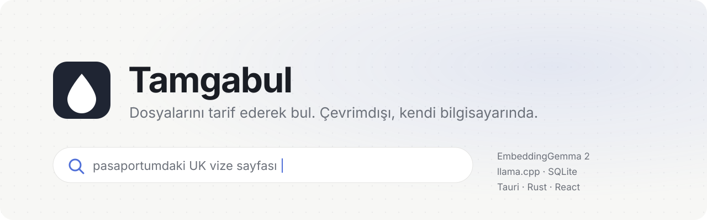
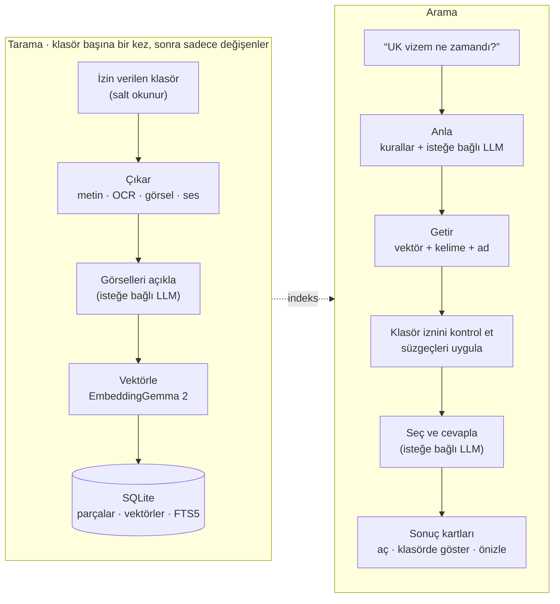
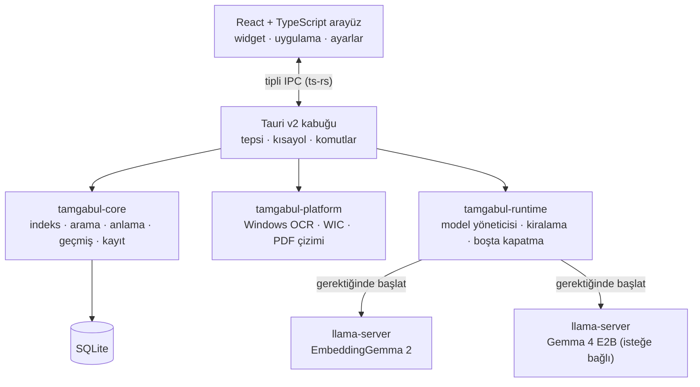

<p align="center">
  <a href="README.md">🇬🇧 English</a>
  &nbsp;·&nbsp;
  <a href="README.tr.md">🇹🇷 Türkçe</a>
</p>

<p align="center">
  <picture>
    <source media="(prefers-color-scheme: dark)" srcset="docs/assets/banner-tr-dark.svg">
    
  </picture>
</p>

<p align="center">
  <a href="https://github.com/hikmetbozkurt/Tamgabul/actions/workflows/ci.yml"></a>
  
  
  
</p>

<p align="center">
  <a href="#neden-tamgabul">Neden</a> ·
  <a href="#özellikler">Özellikler</a> ·
  <a href="#nasıl-çalışır">Nasıl çalışır</a> ·
  <a href="#hızlı-başlangıç">Hızlı başlangıç</a> ·
  <a href="#proje-yapısı">Yapı</a> ·
  <a href="#durum-ve-sınırlar">Durum</a> ·
  <a href="#yol-haritası">Yol haritası</a>
</p>

---

**Tamgabul**, bilgisayarındaki dosyaları tarifinden bulan bir masaüstü widget'ı. *“pasaportumdaki UK vize sayfası”* ya da *“geçen haftaki fatura PDF'i”* gibi yazman yeterli. Klasörlerini bir kere gösteriyorsun; belgeleri, görselleri ve ses kayıtlarını yerel modellerle okuyor. Sonra günlük Türkçe ya da İngilizce ile soruyorsun. Hiçbir şey bilgisayarından çıkmıyor.

## Neden Tamgabul

- **Sen tarif et, o bulsun.** Dosya adını ya da klasörünü hatırlaman gerekmez. Arama anlamı, kelimeleri, görsellerdeki yazıyı ve dosya adlarını birlikte kullanır.
- **Yalnızca yerel.** Modeller `llama.cpp` ile senin makinende çalışır. Bulut çıkarımı yok, telemetri yok, model kendiliğinden hiç indirilmez.
- **Dosyalarına dokunulmaz.** Klasörler salt okunur açılır. Bir klasörü kaldırınca indeksi hemen silinir; dosyaların asla silinmez.
- **Modeller bellekte oturmaz.** Model, bir tarama ya da arama ona ihtiyaç duyunca açılır, boşta kalınca kapanır. Boşta kalma süresini her model için sen seçersin ya da tepsiden hepsini kapatırsın.

## Özellikler

| | Bugün ne yapıyor |
|---|---|
| **Günlük dille arama** | Anlam (EmbeddingGemma 2 vektörleri) + kelime (SQLite FTS5) + dosya adı, reciprocal rank fusion ile birleştirilir. Her sonuç gösterilmeden ve açılmadan önce klasör izinlerine göre yeniden kontrol edilir. |
| **Türkçeye uygun eşleşme** | `toplanti` *Toplantı*'yı, `surum` *sürüm*'ü bulur: I/İ/ı ve aksanlar iki tarafta da aynı şekilde sadeleştirilir. |
| **İsteği anlar** | Kurallar *dün, geçen hafta, bu ay, PDF, ekran görüntüsü, ses kaydı* (ve İngilizce karşılıkları) gibi ifadeleri tarih ve dosya türü süzgecine çevirir. Yalnızca süzgeç içeren bir istek, uyan en yeni dosyaları listeler. |
| **İsteğe bağlı yerel LLM** | Gemma 4 E2B ile: kelimelerinin kök hâlleri ve TR↔EN eş anlamlıları, önceki mesajlara atıf (“şu timer olan”), istenmeyen kelimeler (“X değil”), istek çok belirsizse tek bir netleştirme sorusu, en iyi 20 aday arasından son seçim ve gösterilen bir dosyadan alıntılanmış tek cümlelik cevap. |
| **Görsel açıklamaları** | LLM'in görsel okuyucusu ile her görsel tarama sırasında bir kere açıklanır: ne olduğu, üzerindeki önemli yazılar ve iki dilde arama kelimeleri. Açıklama her metin gibi aranabilir. |
| **Birçok format** | Metin ve kod, Markdown, HTML/XML, RTF, DOCX/PPTX/XLSX, ODT/ODP/ODS, PDF (metin katmanı + taranmış sayfalar için OCR), görseller, ses. Bkz. [desteklenen dosyalar](#desteklenen-dosyalar). |
| **OCR** | Ekran görüntülerindeki ve taranmış PDF'lerdeki yazı, sisteminde kurulu OCR dilleriyle Windows OCR üzerinden okunur. |
| **Önceki sonuçlar** | “Geçen bana bulmuştun” istekleri önce arama geçmişine bakar ve izinleri yeniden kontrol eder; klasörün izni kaldırıldıysa dosyayı göstermeden bunu söyler. |
| **Kaynaklı özetler** | LLM ile seçilen dosyaların kısa özeti; her bilgi geldiği dosyaya bağlanır. “… özetle” isteklerinde daha uzun özet yazılır. |
| **Konuşma hafızası** | Oturumlar, istekler ve gösterilen sonuçlar yerel SQLite'ta tutulur. Sonuçlar referans olarak saklanır ve her okumada yeniden kontrol edilir; izni kaldırılan bir klasör eski konuşmalardan da kaybolur. Geçmiş kapatılabilir. |
| **Tepsi widget'ı** | Sistem tepsisinde yaşar. `Ctrl + Shift + Space` küçük widget'ı açar, widget tam uygulamaya genişler. Kapatınca tepsiye gizlenir; *Quit* tüm model süreçlerini kapatır. |
| **İki dil** | İngilizce ve Türkçe arayüz. |

> [!NOTE]
> LLM özelliklerinin kalitesi modele bağlıdır ve henüz bir değerlendirme setiyle ölçülmedi. Bu README'deki hiçbir şey bir performans iddiası değildir.

## Nasıl çalışır



Modeller, uygulamanın başlatıp denetlediği ayrı `llama-server` süreçleridir. Yalnızca `127.0.0.1` üzerinde, rastgele bir port ve sürece özel bir anahtarla dinlerler. Uygulamaya bağlıdırlar (Windows Job Object), bu yüzden uygulama çökse bile onlar da kapanır.



## Hızlı başlangıç

> [!IMPORTANT]
> Tamgabul pre-alpha aşamasında ve henüz bir kurulum dosyası yok. Bu adımlar Windows 10/11'de kaynaktan derleyip çalıştırır.

### 1. Gerekenler

- [Rust](https://rustup.rs/) stable, MSVC araç zinciriyle (Visual Studio Build Tools → *Desktop development with C++*)
- [Node.js](https://nodejs.org/) 20 veya üstü (22 önerilir)
- WebView2 Runtime (Windows 11'de hazır gelir)
- `llama.cpp` sunucusu:

```powershell
winget install ggml.llamacpp
```

### 2. Modelleri indir

Modeller repoda değildir ve uygulama onları hiç indirmez. İstediğin yere koyabilirsin; aşağıda `C:\AI\models\` kullanılıyor.

**EmbeddingGemma 2 (zorunlu).** Metin modeli ile görsel ve ses için okuyucu dosyası, [`ggml-org/embeddinggemma-2-GGUF`](https://huggingface.co/ggml-org/embeddinggemma-2-GGUF) deposundan:

```powershell
$d = "C:\AI\models\embeddinggemma-2"; New-Item -ItemType Directory -Force $d | Out-Null
$r = "https://huggingface.co/ggml-org/embeddinggemma-2-GGUF/resolve/6ea3e3a309d12a4779cfda98b8c19800d2d5da71"
curl.exe -L --fail -o "$d\embeddinggemma-2-BF16.gguf"        "$r/embeddinggemma-2-BF16.gguf"
curl.exe -L --fail -o "$d\mmproj-embeddinggemma-2-BF16.gguf" "$r/mmproj-embeddinggemma-2-BF16.gguf"
```

**Gemma 4 E2B-it (isteğe bağlı, önerilir).** İsteği anlama, son seçim ve görsel açıklamaları bu modelle yapılır. [`ggml-org/gemma-4-E2B-it-GGUF`](https://huggingface.co/ggml-org/gemma-4-E2B-it-GGUF) deposundan:

```powershell
$d = "C:\AI\models\gemma-4-e2b-it"; New-Item -ItemType Directory -Force $d | Out-Null
$r = "https://huggingface.co/ggml-org/gemma-4-E2B-it-GGUF/resolve/main"
curl.exe -L --fail -o "$d\gemma-4-E2B-it-Q4_0.gguf"        "$r/gemma-4-E2B-it-Q4_0.gguf"
curl.exe -L --fail -o "$d\mmproj-gemma-4-E2B-it-Q8_0.gguf" "$r/mmproj-gemma-4-E2B-it-Q8_0.gguf"
```

<details>
<summary>Beklenen SHA-256 değerleri (model eklerken uygulama da bunları kontrol eder)</summary>

| Dosya | SHA-256 |
|---|---|
| `embeddinggemma-2-BF16.gguf` | `68bae29d62fb8c7d23e98d21fd4662753ddd636e6b62b8a70dfe059a9844f216` |
| `mmproj-embeddinggemma-2-BF16.gguf` | `cc8d7eb30a9984c5128d6b1ccdec7510bfce213dc92a840be0d20e2a62b26bcd` |
| `gemma-4-E2B-it-Q4_0.gguf` | `8e30dff3ac4c8434c49a7036fa15564bdbb6044e42bf04550bf1a096ad7e6a52` |
| `mmproj-gemma-4-E2B-it-Q8_0.gguf` | `9406f99c16d68cda4f1f0552192dcc99021ea1fc6d2fd50b1dc3ccf30d04b292` |

```powershell
Get-FileHash "C:\AI\models\gemma-4-e2b-it\gemma-4-E2B-it-Q4_0.gguf" -Algorithm SHA256
```

Farklı bir hash'e sahip dosya da doğrulamayı geçerse çalışır; yalnızca *resmî dosya değil* olarak gösterilir.
</details>

### 3. Derle ve çalıştır

```powershell
git clone https://github.com/hikmetbozkurt/Tamgabul.git
cd Tamgabul\apps\desktop
npm install
npm run tauri dev
```

Tepsi ikonu görünür ve widget sağ altta açılır.

### 4. İlk kullanım

1. **Models → Add model → Embedding**, ardından `C:\AI\models\embeddinggemma-2` klasörünü seç. Uygulama dosyayı, formatı, SHA-256'yı ve çalıştırıcıyı kontrol eder, kısa bir deneme çalıştırması yapar. Sonra **Save**.
2. *(İsteğe bağlı)* **Models → Add model → LLM**, ardından `C:\AI\models\gemma-4-e2b-it`.
3. **Folders → Add folder**. Önizleme, dosya sayısını ve otomatik hariç tutulanları gösterir (`.git`, `node_modules`, sistem klasörleri, yalnızca bulutta duran dosyalar). Sonra **Allow and scan**.
4. Widget'tan ya da Search sayfasından sor. `Ctrl + Shift + Space` widget'ı her yerden açar.

Görsellerdeki Türkçe yazı için Türkçe dilini OCR özelliğiyle birlikte kur: *Ayarlar → Saat ve dil → Dil*.

## Desteklenen dosyalar

| Tür | Formatlar | Nasıl okunur |
|---|---|---|
| Metin ve kod | `md`, `txt`, `csv`, `json`, `yaml`, `log`, `srt`, ~100 kod uzantısı; `html`, `xml`, `svg`; `rtf` | UTF-8 / UTF-16 / Windows-1254 çözümleme, satır numaralarıyla parçalara bölünür |
| Belgeler | `docx`, `pptx`, `xlsx`, `odt`, `odp`, `ods` | belgenin XML'inden metin |
| PDF | `pdf` | metin katmanı; neredeyse hiç metni olmayan sayfalar görüntüye çevrilip OCR'lanır (Windows) |
| Görseller | `png`, `jpg`, `gif`, `bmp`, `ico`, `tiff`, `webp`, `tga`, `pnm`, `dds`, `hdr`, `exr`, `qoi`; Windows kodeği kuruluysa `heic`, `avif`, `jxr`, kamera RAW | görsel vektörü + OCR yazısı + isteğe bağlı LLM açıklaması |
| Ses | `wav`, `mp3`, `m4a`/`aac`, `flac`, `ogg`, `aiff`, `caf`, `mka` | EmbeddingGemma 2'nin ses kodlayıcısıyla 30 sn'lik parçalar |

Okunmayanlar: eski `.doc` / `.xls` / `.ppt`, Opus, WMA, video.

## Proje yapısı

```text
apps/desktop/
  src/                 React + TypeScript arayüz (widget, uygulama, i18n, tipli IPC)
  src-tauri/           Tauri v2 kabuğu: komutlar, tepsi, kısayol, model ve klasör bağlantıları
crates/
  core/                SQLite şeması, indeksleme, arama, istek anlama, görsel açıklamaları,
                       sonuç seçimi, geçmiş, model kaydı
  platform/            İşletim sistemi servisleri: Windows OCR, WIC görsel çözümleme, PDF sayfa çizimi
  runtime/             llama-server süreçleri, GGUF kontrolü, model yöneticisi, deneme testleri, spike'lar
database/              SQL migration'ları (core'a gömülür)
docs/                  ürün ve mühendislik belgeleri, ADR'ler, araştırma kaydı
agent_tasks/           kabul kriterli faz görevleri
```

## Geliştirme

```powershell
cargo test --workspace                                  # Rust testleri; TS tiplerini de üretir
cargo clippy --workspace --all-targets -- -D warnings
cd apps\desktop
npm run typecheck
npm test
```

Gerçek model dosyalarınla spike'lar (yalnızca ölçülen değerleri yazan geliştirici araçları):

```powershell
cargo run -p tamgabul-runtime --release --example eg2_spike -- --models C:\AI\models\embeddinggemma-2
cargo run -p tamgabul-runtime --release --example llm_spike -- --model  C:\AI\models\gemma-4-e2b-it
```

Ayrıntılar [`DEVELOPMENT.md`](DEVELOPMENT.md) dosyasında. Mühendislik kararları [`docs/20_ADR.md`](docs/20_ADR.md), belge dizini [`docs/00_INDEX.md`](docs/00_INDEX.md) içinde. Başlangıç rehberi: [`START_HERE_TR.md`](START_HERE_TR.md).

## Durum ve sınırlar

- **Pre-alpha.** Windows'ta derlenip test ediliyor. macOS planlı (aynı kod tabanı); Linux'ta henüz işletim sistemi servisleri (OCR, ek kodekler, PDF çizimi) yok.
- **Kurulum dosyası yok.** `llama-server` winget'ten gelir, modeller elle eklenir.
- **Henüz ölçüm yok.** Yükleme süresi, bellek, tarama hızı ve arama kalitesi gerçek bir makinede ölçülmedi. İki dilli değerlendirme seti ve çalıştırıcısı [`examples/eval/`](examples/eval/README.md) klasöründe. Görsel açıklamalı ilk tarama belirgin şekilde daha yavaştır, çünkü LLM her görsele bir kere bakar.
- **Ses dosyaları** sesin anlamından ve dosya adından bulunur; konuşmayı yazıya çevirme (STT) henüz yok.
- **Sesli giriş/çıkış (STT/TTS)** henüz yapılmadı.
- **Klasör izleme** henüz yok. Değişiklikler için klasörü yeniden tara (yalnızca değişen dosyalar işlenir).

## Yol haritası

| Faz | Kapsam | Durum |
|---|---|---|
| P0 | Repo, CI, arayüz iskeleti, runtime spike'ları | bitti |
| P1 | Klasör izinleri, güvenli tarama, tüm formatlar, OCR, izin kaldırma + temizleme | bitti |
| P2 | Hibrit arama, sonuç kartları, aç / klasörde göster / önizle | bitti |
| P3 | Geçmiş, istek anlama, LLM seçimi, görsel açıklamaları | sürüyor |
| P4 | Model kaydı, doğrulama, gerektiğinde yükleme, boşta kapatma | bitti (embedding + LLM) |
| P5 | Tepsi widget'ı, kısayol, ilk kurulum | bitti, cilalanıyor |
| P6 | Ses (STT / TTS), paketleme | planlı |
| P7 | Windows sürüm kapısı: kurulum dosyası, güvenlik ve değerlendirme matrisi | planlı |
| P8 | macOS uyumu | planlı |

Tam plan: [`docs/15_ROADMAP.md`](docs/15_ROADMAP.md).

## Gizlilik

- Hiçbir şey yüklenmez. Hesap, telemetri ya da uzak çıkarım yoktur.
- Model süreçleri yalnızca `127.0.0.1`'e bağlanır ve rastgele bir anahtar ister.
- Dosyalardan gelen içerik (OCR yazısı ve görsel açıklamaları dahil) veri olarak işlenir, asla talimat olarak değil. LLM çıktısı bir dilbilgisiyle sabit JSON şekillerine sınırlıdır; dosya açamaz, arama kapsamını genişletemez.
- Bir klasörü kaldırmak sonuçlarını hemen engeller, ardından indeksini temizler.

## Lisans

Henüz bir lisans seçilmedi. Bir `LICENSE` dosyası eklenene kadar tüm hakları yazara aittir. Modellerin ve çalıştırıcının kendi lisansları var: yukarıdaki GGUF dosyaları Hugging Face'te Apache-2.0 olarak işaretli (her model kartını kontrol et), `llama.cpp` MIT lisanslı.

## Teşekkürler

[llama.cpp](https://github.com/ggml-org/llama.cpp) · [EmbeddingGemma 2](https://huggingface.co/ggml-org/embeddinggemma-2-GGUF) · [Gemma 4](https://huggingface.co/ggml-org/gemma-4-E2B-it-GGUF) · [Tauri](https://tauri.app/) · [SQLite FTS5](https://www.sqlite.org/fts5.html) · [Symphonia](https://github.com/pdeljanov/Symphonia)
